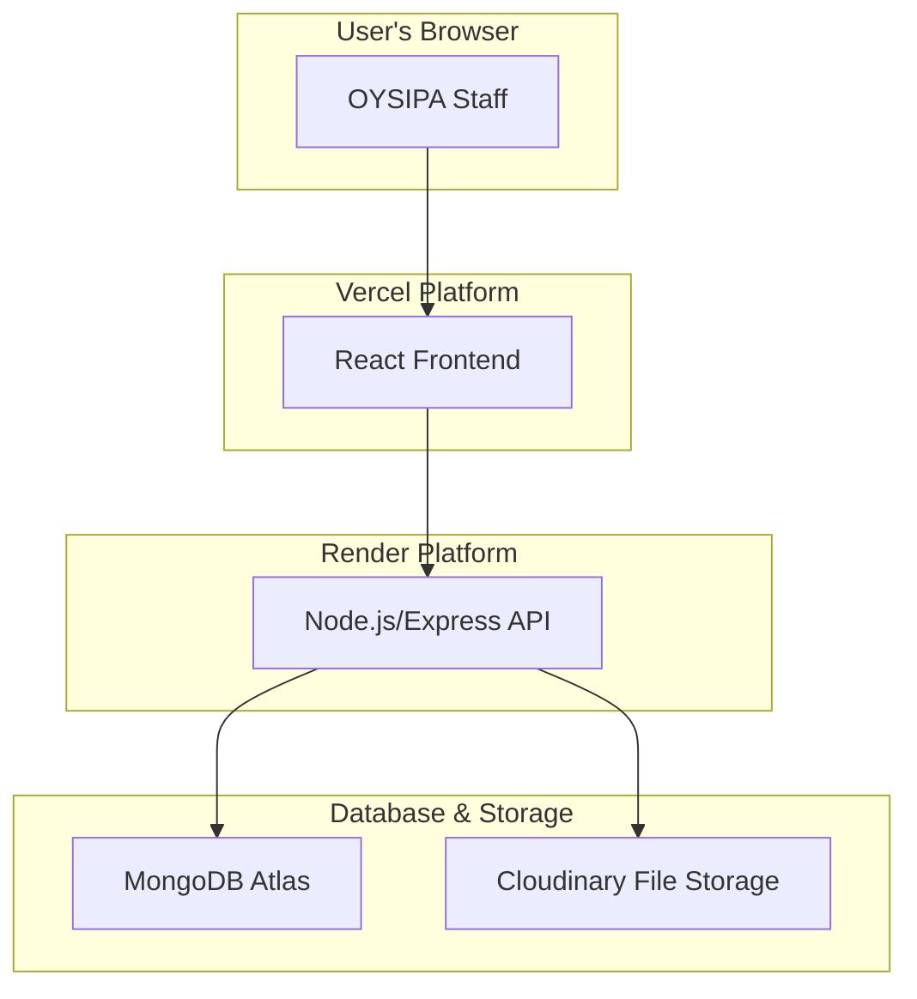

# OYSIPA Investor Tracking System & CRM Fullstack Architecture Document

## 1. Introduction

This document outlines the complete fullstack architecture for the OYSIPA Investor Tracking System & CRM, including backend systems, frontend implementation, and their integration. It serves as the single source of truth for AI-driven development, ensuring consistency across the entire technology stack.

This architecture defines a decoupled system with a React frontend and a separate backend service, providing clear separation of concerns and independent deployment capabilities.

### 1.1. Starter Template or Existing Project

N/A - This is a greenfield project being built from scratch.

### 1.2. Change Log

| Date | Version | Description | Author |
| :--- | :--- | :--- | :--- |
| 2025-09-19 | 1.0 | Initial Draft based on user-specified stack | Winston (Architect) |

## 2. High Level Architecture

### 2.1. Technical Summary

The proposed architecture is a modern, decoupled, full-stack application. The frontend will be a **React (Vite)** single-page application, hosted on **Vercel** for optimal performance and continuous deployment. The backend will be a **Node.js with Express** API service, hosted on **Render**, which will handle all business logic and data processing. Data will be persisted in a **MongoDB Atlas** cluster, a managed NoSQL database solution. This stack provides a clear separation of concerns, allowing the frontend and backend to be developed, scaled, and deployed independently while meeting the project's requirements.

### 2.2. Platform and Infrastructure Choice

**Platform:** A combination of specialized cloud providers.
**Key Services:**
- **Vercel:** For continuous deployment and hosting of the React frontend application.
- **Render:** For hosting the backend Node.js/Express API service.
- **MongoDB Atlas:** For the managed MongoDB database cluster.
- **Cloudinary:** For secure file storage and delivery.
**Deployment Host and Regions:** US-East (Default for all services)

### 2.3. Repository Structure

**Structure:** Poly-repo (two separate repositories).
**Rationale:** Given the separate hosting platforms for frontend (Vercel) and backend (Render), a poly-repo approach is the most straightforward for configuration and deployment. It creates a clean separation between the two parts of the codebase.
- `oysipa-frontend`: Contains the React application.
- `oysipa-backend`: Contains the Node.js API service.

### 2.4. High Level Architecture Diagram



### 2.5. Architectural Patterns
- **Decoupled Frontend/Backend:** The frontend (presentation) and backend (business logic) are separate applications. _Rationale:_ This allows for independent development, deployment, and scaling, and enables a clear contract via the API.
- **REST API:** The backend will expose a RESTful API for the frontend to consume. _Rationale:_ This is a mature, well-understood standard for web APIs that is framework-agnostic.
- **Component-Based UI:** The React frontend will be built using reusable components, as defined in the UI/UX Specification. _Rationale:_ Enhances maintainability and consistency.
- **Repository Pattern (Backend):** Data access logic will be abstracted into a repository layer to decouple the Express services from MongoDB. _Rationale:_ This makes the code cleaner, easier to test, and allows for easier data-layer modifications in the future.

## 3. Tech Stack

### 3.1. Technology Stack Table

| Category | Technology | Version | Purpose | Rationale |
| :--- | :--- | :--- | :--- | :--- |
| Frontend Language | JavaScript (ES6+) | Latest | Core language for React | User-specified. Modern JavaScript provides robust features for development. |
| Frontend Framework | React | ~18.2.0 | Building the user interface | User-specified. The leading library for building modern UIs. |
| UI Component Library| Material-UI (MUI) | ~5.15.0 | Pre-built, accessible UI components | Speeds up development and ensures a consistent, professional look. |
| CSS Styling | MUI `sx` prop | N/A | Component-level styling | User-specified. Keeps styles co-located with components and leverages the MUI theme. |
| State Management | Zustand | ~4.5.0 | Simple, scalable state management | Lightweight and minimal boilerplate compared to Redux for this project's scale. |
| Backend Language | JavaScript (ES6+) | Latest | Core language for Node.js | User-specified. Consistent language across the full stack. |
| Backend Framework | Express.js | ~4.18.2 | API routing and middleware | Minimal, fast, and the de-facto standard for Node.js APIs. |
| API Style | REST | N/A | Standard for web APIs | Well-understood, stateless, and framework-agnostic. |
| Database | MongoDB | 7.0+ | Primary data storage | User-specified. A flexible NoSQL database suitable for evolving requirements. |
| Database ODM | Mongoose | ~8.2.0 | MongoDB object modeling | Provides schema validation and simplifies interaction with MongoDB from JavaScript. |
| File Storage | Cloudinary | N/A | Storing uploaded documents | User-specified. A robust, managed service for file uploads, transformations, and delivery. |
| Authentication | JSON Web Tokens (JWT)| ~9.0.2 | Securely transmitting information | Standard, stateless method for authenticating API requests. |
| Frontend Testing | Vitest + RTL | Latest | Unit & Component Testing | Modern, fast testing framework integrated with Vite. React Testing Library encourages good practices. |
| Backend Testing | Jest + Supertest | ~29.x.x | Unit & API Endpoint Testing | Jest is a comprehensive testing framework. Supertest simplifies HTTP assertions. |
| Build Tool | Vite | ~5.1.0 | Frontend dev server and bundler | Extremely fast development server and optimized production builds. |
| CI/CD | GitHub Actions | N/A | Automated testing and deployment | Natively integrated with GitHub, excellent for setting up separate FE/BE deployment pipelines. |
| Monitoring | Vercel/Render Dashboards| N/A | Basic health and usage monitoring | Provides essential monitoring out-of-the-box for the MVP without extra setup. |
| Logging | Vercel/Render Runtimes| N/A | Capturing application logs | Provides essential logging out-of-the-box for the MVP. |

## 4. Data Models

This section defines the core data entities for the application. Since the project uses plain JavaScript, we will use JSDoc comments to document the schema for each model, providing clarity and enabling editor support.

### 4.1. Model: User

**Purpose:** Represents an individual who can log in to the system. Each user has a specific role that dictates their permissions.

**Key Attributes:**
- `_id`: `ObjectId` - Unique identifier automatically generated by MongoDB.
- `name`: `String` - The user's full name. Required.
- `email`: `String` - The user's unique email address, used for login. Required, unique.
- `password`: `String` - The user's hashed password. Required.
- `role`: `String` - The user's role. Must be one of: 'Staff', 'Portal Administrator', 'Director-General'. Required.
- `status`: `String` - The user's account status. Must be one of: 'Active', 'Invited', 'Revoked'. Defaults to 'Invited'. Required.

#### JSDoc Definition
```javascript
/**
 * @typedef {object} User
 * @property {string} _id - MongoDB ObjectId
 * @property {string} name
 * @property {string} email
 * @property {string} role - ('Staff'|'Portal Administrator'|'Director-General')
 * @property {string} status - ('Active'|'Invited'|'Revoked')
 */
```

#### Relationships
- **Assigned Investors (One-to-Many):** A `User` with the 'Staff' role can be the assigned contact for many `Investor` documents. This will be implemented by storing the User's `_id` in the `assignedTo` field of the `Investor` model.

### 4.2. Model: Investor

**Purpose:** Represents the core business entity in the CRM. It holds all high-level information about a company or individual that the agency is engaging with.

**Key Attributes:**
- `_id`: `ObjectId` - Unique identifier automatically generated by MongoDB.
- `name`: `String` - The legal name of the investing entity. Required, unique.
- `sector`: `String` - The industry sector (e.g., 'Agriculture', 'Technology'). Required.
- `countryOfOrigin`: `String` - The investor's home country.
- `companyRegistrationInfo`: `String` - Registration number or other legal identifiers.
- `assignedTo`: `ObjectId` - A reference to the `_id` of the assigned `User` (staff member). Can be null.
- `createdAt`: `Date` - Timestamp of when the record was created. Automatically generated.
- `updatedAt`: `Date` - Timestamp of the last update. Automatically generated.

#### JSDoc Definition
```javascript
/**
 * @typedef {object} Investor
 * @property {string} _id - MongoDB ObjectId
 * @property {string} name
 * @property {string} sector
 * @property {string} countryOfOrigin
 * @property {string} companyRegistrationInfo
 * @property {string} [assignedTo] - ObjectId of the assigned User
 * @property {Date} createdAt
 * @property {Date} updatedAt
 */
```

#### Relationships
- **Assigned User (Many-to-One):** Many `Investor` documents can be assigned to one `User`. Implemented by storing the `User._id` in the `assignedTo` field.
- **Projects (One-to-Many):** One `Investor` can have many `Investment Projects`. This is a one-sided relationship where `Project` documents will store a reference to their parent `Investor._id`.
- **Contacts (One-to-Many):** One `Investor` can have many `Contact` people. This is a one-sided relationship where `Contact` documents will store a reference to their parent `Investor._id`.

### 4.3. Model: InvestmentProject

**Purpose:** Represents a specific venture or initiative undertaken by an investor. This is the primary object that staff members interact with and track through the investment lifecycle.

**Key Attributes:**
- `_id`: `ObjectId` - Unique identifier automatically generated by MongoDB.
- `title`: `String` - The official title of the project. Required.
- `description`: `String` - A detailed description of the project.
- `estimatedValue`: `Number` - The financial value of the project.
- `location`: `String` - The physical location of the project within the state.
- `lifecycleStage`: `ObjectId` - A reference to the `_id` of the current `LifecycleStage`. Required.
- `investor`: `ObjectId` - A reference to the `_id` of the parent `Investor`. Required.
- `createdAt`: `Date` - Timestamp of when the record was created. Automatically generated.
- `updatedAt`: `Date` - Timestamp of the last update. Automatically generated.

#### JSDoc Definition
```javascript
/**
 * @typedef {object} InvestmentProject
 * @property {string} _id - MongoDB ObjectId
 * @property {string} title
 * @property {string} description
 * @property {number} estimatedValue
 * @property {string} location
 * @property {string} lifecycleStage - ObjectId of the LifecycleStage
 * @property {string} investor - ObjectId of the parent Investor
 * @property {Date} createdAt
 * @property {Date} updatedAt
 */
```

#### Relationships
- **Parent Investor (Many-to-One):** Many `InvestmentProject` documents belong to one `Investor`. Implemented by storing the `Investor._id` in the `investor` field.
- **Interaction Logs (One-to-Many):** One `InvestmentProject` can have many `InteractionLog` entries. This is a one-sided relationship where `InteractionLog` documents will store a reference to their parent `InvestmentProject._id`.
- **Lifecycle Stage (Many-to-One):** Many `InvestmentProject` documents can be at the same `LifecycleStage`. Implemented by storing the `LifecycleStage._id` in the `lifecycleStage` field.

### 4.4. Model: InteractionLog

**Purpose:** To record a single, timestamped support activity or event related to an investment project. This creates the auditable history of engagement.

**Key Attributes:**
- `_id`: `ObjectId` - Unique identifier automatically generated by MongoDB.
- `project`: `ObjectId` - A reference to the `_id` of the parent `InvestmentProject`. Required.
- `loggedBy`: `ObjectId` - A reference to the `_id` of the `User` who created the log entry. Required.
- `description`: `String` - A detailed description of the interaction. Required.
- `category`: `String` - The category of service provided, based on the OYSIPA framework. Required.
- `documentUrl`: `String` - An optional URL pointing to a supporting document stored in Cloudinary.
- `createdAt`: `Date` - Timestamp of when the log was created. Automatically generated.

#### JSDoc Definition
```javascript
/**
 * @typedef {object} InteractionLog
 * @property {string} _id - MongoDB ObjectId
 * @property {string} project - ObjectId of the parent InvestmentProject
 * @property {string} loggedBy - ObjectId of the User who created the log
 * @property {string} description
 * @property {string} category
 * @property {string} [documentUrl]
 * @property {Date} createdAt
 */
```

#### Relationships
- **Parent Project (Many-to-One):** Many `InteractionLog` entries belong to one `InvestmentProject`. Implemented by storing the `InvestmentProject._id` in the `project` field.
- **Author (Many-to-One):** Many `InteractionLog` entries can be created by one `User`. Implemented by storing the `User._id` in the `loggedBy` field.

### 4.5. Model: LifecycleStage

**Purpose:** To define the distinct, ordered stages of the investment pipeline. This allows projects to be categorized and tracked consistently. These stages are manageable by an Administrator (as per Story 5.1).

**Key Attributes:**
- `_id`: `ObjectId` - Unique identifier automatically generated by MongoDB.
- `name`: `String` - The display name of the stage (e.g., "Initial Inquiry"). Required, unique.
- `order`: `Number` - A number that determines the position of the stage in the pipeline, allowing for custom ordering. Required, unique.
- `description`: `String` - An optional description of what this stage entails.

#### JSDoc Definition
```javascript
/**
 * @typedef {object} LifecycleStage
 * @property {string} _id - MongoDB ObjectId
 * @property {string} name
 * @property {number} order
 * @property {string} [description]
 */
```

#### Relationships
- **Projects (One-to-Many):** One `LifecycleStage` can be applied to many `InvestmentProject` documents. This is a one-sided relationship where `InvestmentProject` documents store a reference to the `LifecycleStage._id`.

### 4.6. Model: Contact

**Purpose:** To store contact information for individuals associated with an investor entity. This allows OYSIPA staff to know who to communicate with for each investor.

**Key Attributes:**
- `_id`: `ObjectId` - Unique identifier automatically generated by MongoDB.
- `investor`: `ObjectId` - A reference to the `_id` of the parent `Investor`. Required.
- `name`: `String` - The contact's full name. Required.
- `email`: `String` - The contact's email address.
- `phone`: `String` - The contact's phone number.
- `role`: `String` - The contact's role at the company (e.g., "CEO", "Project Manager").
- `isPrimary`: `Boolean` - Indicates if this is the main contact for the investor. Defaults to `false`.

#### JSDoc Definition
```javascript
/**
 * @typedef {object} Contact
 * @property {string} _id - MongoDB ObjectId
 * @property {string} investor - ObjectId of the parent Investor
 * @property {string} name
 * @property {string} [email]
 * @property {string} [phone]
 * @property {string} [role]
 * @property {boolean} isPrimary
 */
```

#### Relationships
- **Parent Investor (Many-to-One):** Many `Contact` documents can belong to one `Investor`. Implemented by storing the `Investor._id` in the `investor` field.

## 5. API Specification

### 5.1. REST API Specification (OpenAPI)

This section defines the REST API contract using the OpenAPI 3.0 standard.

```yaml
openapi: 3.0.3
info:
  title: OYSIPA Investor Tracking System API
  description: The API for the OYSIPA Investor Tracking System & CRM.
  version: 1.0.0
servers:
  - url: https://oysipa-backend.onrender.com/api/v1
    description: Production Server
  - url: http://localhost:3001/api/v1
    description: Local Development Server
tags:
  - name: Authentication
    description: User authentication and registration
  - name: Investors
    description: Operations about investors
  - name: Projects
    description: Operations about investment projects
  - name: Interactions
    description: Logging and retrieving project interactions
# 1. API Endpoints (Paths)
paths:
  /auth/login:
    post:
      summary: User Login
      tags:
        - Authentication
      requestBody:
        required: true
        content:
          application/json:
            schema:
              $ref: '#/components/schemas/LoginRequest'
      responses:
        '200':
          description: Successful login
          content:
            application/json:
              schema:
                $ref: '#/components/schemas/AuthResponse'
        '401':
          description: Unauthorized
          content:
            application/json:
              schema:
                $ref: '#/components/schemas/ErrorResponse'

  /auth/register:
    post:
      summary: Register a new user via invitation
      tags:
        - Authentication
      description: This endpoint is used by a new user clicking the link in their invitation email.
      requestBody:
        required: true
        content:
          application/json:
            schema:
              $ref: '#/components/schemas/RegisterRequest'
      responses:
        '201':
          description: User successfully created
          content:
            application/json:
              schema:
                $ref: '#/components/schemas/UserResponse'
        '400':
          description: Bad request (e.g., invalid token, password too weak)
          content:
            application/json:
              schema:
                $ref: '#/components/schemas/ErrorResponse'
  /investors:
    get:
      summary: List all investors
      tags: [Investors]
      security:
        - bearerAuth: []
      parameters:
        - in: query
          name: limit
          schema: { type: integer, default: 20 }
        - in: query
          name: offset
          schema: { type: integer, default: 0 }
        - in: query
          name: sortBy
          schema: { type: string, default: 'createdAt' }
      responses:
        '200':
          description: A list of investors.
          content:
            application/json:
              schema:
                type: array
                items:
                  $ref: '#/components/schemas/Investor'
    post:
      summary: Create a new investor
      tags: [Investors]
      security:
        - bearerAuth: []
      requestBody:
        required: true
        content:
          application/json:
            schema:
              $ref: '#/components/schemas/InvestorRequest'
      responses:
        '201':
          description: Investor created successfully
          content:
            application/json:
              schema:
                $ref: '#/components/schemas/Investor'

  /investors/{id}:
    get:
      summary: Get a single investor by ID
      tags: [Investors]
      security:
        - bearerAuth: []
      parameters:
        - in: path
          name: id
          required: true
          schema: { type: string }
      responses:
        '200':
          description: A single investor object.
          content:
            application/json:
              schema:
                $ref: '#/components/schemas/Investor'
        '404':
          description: Investor not found
    put:
      summary: Update an investor
      tags: [Investors]
      security:
        - bearerAuth: []
      parameters:
        - in: path
          name: id
          required: true
          schema: { type: string }
      requestBody:
        required: true
        content:
          application/json:
            schema:
              $ref: '#/components/schemas/InvestorRequest'
      responses:
        '200':
          description: Investor updated successfully
          content:
            application/json:
              schema:
                $ref: '#/components/schemas/Investor'
    delete:
      summary: Delete an investor
      tags: [Investors]
      security:
        - bearerAuth: []
      parameters:
        - in: path
          name: id
          required: true
          schema: { type: string }
      responses:
        '204':
          description: Investor deleted successfully

  /investors/{investorId}/projects:
    get:
      summary: List all projects for an investor
      tags: [Projects]
      security:
        - bearerAuth: []
      parameters:
        - in: path
          name: investorId
          required: true
          schema: { type: string }
      responses:
        '200':
          description: A list of projects for the specified investor.
          content:
            application/json:
              schema:
                type: array
                items:
                  $ref: '#/components/schemas/InvestmentProject'
    post:
      summary: Create a new project for an investor
      tags: [Projects]
      security:
        - bearerAuth: []
      parameters:
        - in: path
          name: investorId
          required: true
          schema: { type: string }
      requestBody:
        required: true
        content:
          application/json:
            schema:
              $ref: '#/components/schemas/InvestmentProjectRequest'
      responses:
        '201':
          description: Project created successfully
          content:
            application/json:
              schema:
                $ref: '#/components/schemas/InvestmentProject'

  /projects/{id}:
    get:
      summary: Get a single project by ID
      tags: [Projects]
      security:
        - bearerAuth: []
      parameters:
        - in: path
          name: id
          required: true
          schema: { type: string }
      responses:
        '200':
          description: A single project object.
          content:
            application/json:
              schema:
                $ref: '#/components/schemas/InvestmentProject'
        '404':
          description: Project not found
    put:
      summary: Update a project
      tags: [Projects]
      security:
        - bearerAuth: []
      parameters:
        - in: path
          name: id
          required: true
          schema: { type: string }
      requestBody:
        required: true
        content:
          application/json:
            schema:
              $ref: '#/components/schemas/InvestmentProjectRequest'
      responses:
        '200':
          description: Project updated successfully
          content:
            application/json:
              schema:
                $ref: '#/components/schemas/InvestmentProject'
    delete:
      summary: Delete a project
      tags: [Projects]
      security:
        - bearerAuth: []
      parameters:
        - in: path
          name: id
          required: true
          schema: { type: string }
      responses:
        '204':
          description: Project deleted successfully

  /projects/{projectId}/interactions:
    get:
      summary: List all interaction logs for a project
      tags: [Interactions]
      security:
        - bearerAuth: []
      parameters:
        - in: path
          name: projectId
          required: true
          schema: { type: string }
      responses:
        '200':
          description: A list of interaction logs for the specified project.
          content:
            application/json:
              schema:
                type: array
                items:
                  $ref: '#/components/schemas/InteractionLog'
    post:
      summary: Create a new interaction log for a project
      tags: [Interactions]
      security:
        - bearerAuth: []
      parameters:
        - in: path
          name: projectId
          required: true
          schema: { type: string }
      requestBody:
        required: true
        content:
          application/json:
            schema:
              $ref: '#/components/schemas/InteractionLogRequest'
      responses:
        '201':
          description: Interaction log created successfully
          content:
            application/json:
              schema:
                $ref: '#/components/schemas/InteractionLog'

# 2. Reusable Components (Schemas)
components:
  schemas:
    # Base Models
    User:
      type: object
      properties:
        id:
          type: string
          example: '60d0fe4f5311236168a109ca'
        name:
          type: string
          example: 'John Doe'
        email:
          type: string
          format: email
          example: 'john.doe@oysipa.gov.ng'
        role:
          type: string
          enum: [Staff, Portal Administrator, Director-General]
          example: 'Staff'

    Investor:
      type: object
      properties:
        id:
          type: string
        name:
          type: string
        sector:
          type: string
        countryOfOrigin:
          type: string
        companyRegistrationInfo:
          type: string
        assignedTo:
          type: string
          description: User ID
        createdAt:
          type: string
          format: date-time
        updatedAt:
          type: string
          format: date-time

    InvestmentProject:
      type: object
      properties:
        id:
          type: string
        title:
          type: string
        description:
          type: string
        estimatedValue:
          type: number
        location:
          type: string
        lifecycleStage:
          type: string
          description: LifecycleStage ID
        investor:
          type: string
          description: Investor ID
        createdAt:
          type: string
          format: date-time
        updatedAt:
          type: string
          format: date-time

    InteractionLog:
      type: object
      properties:
        id:
          type: string
        project:
          type: string
        loggedBy:
          $ref: '#/components/schemas/UserResponse' # Nested user details
        description:
          type: string
        category:
          type: string
        documentUrl:
          type: string
        createdAt:
          type: string
          format: date-time

    # Request/Response Schemas
    LoginRequest:
      type: object
      required: [email, password]
      properties:
        email:
          type: string
          format: email
        password:
          type: string
          format: password

    RegisterRequest:
      type: object
      required: [name, password, inviteToken]
      properties:
        name:
          type: string
        password:
          type: string
          format: password
        inviteToken:
          type: string

    AuthResponse:
      type: object
      properties:
        token:
          type: string
          example: 'eyJhbGciOiJIUzI1NiIsInR5cCI6IkpXVCJ9...'
        user:
          $ref: '#/components/schemas/User'

    UserResponse:
      type: object
      properties:
        id:
          type: string
        name:
          type: string
        email:
          type: string
        role:
          type: string

    InvestorRequest:
      type: object
      required: [name, sector]
      properties:
        name:
          type: string
        sector:
          type: string
        countryOfOrigin:
          type: string
        companyRegistrationInfo:
          type: string
        assignedTo:
          type: string
          description: User ID

    InvestmentProjectRequest:
      type: object
      required: [title, lifecycleStage]
      properties:
        title:
          type: string
        description:
          type: string
        estimatedValue:
          type: number
        location:
          type: string
        lifecycleStage:
          type: string
          description: LifecycleStage ID

    InteractionLogRequest:
      type: object
      required: [description, category]
      properties:
        description:
          type: string
        category:
          type: string
        documentUrl:
          type: string

    ErrorResponse:
      type: object
      required: [message]
      properties:
        message:
          type: string
          example: 'Invalid credentials'

  securitySchemes:
    bearerAuth:
      type: http
      scheme: bearer
      bearerFormat: JWT

# 3. Security Definitions
security:
  - bearerAuth: []
```

## 6. Database Schema

This section provides the concrete Mongoose schemas that will be used in the backend to model and validate data in MongoDB.

### 6.1. User Schema
```javascript
import mongoose from 'mongoose';
import bcrypt from 'bcryptjs';

const userSchema = new mongoose.Schema({
  name: { type: String, required: true },
  email: { type: String, required: true, unique: true, lowercase: true },
  password: { type: String, required: true },
  role: { 
    type: String, 
    enum: ['Staff', 'Portal Administrator', 'Director-General'], 
    required: true 
  },
  status: { 
    type: String, 
    enum: ['Active', 'Invited', 'Revoked'], 
    default: 'Invited', 
    required: true 
  }
}, { timestamps: true });

// Hash password before saving
userSchema.pre('save', async function(next) {
  if (!this.isModified('password')) return next();
  const salt = await bcrypt.genSalt(10);
  this.password = await bcrypt.hash(this.password, salt);
  next();
});

export default mongoose.model('User', userSchema);
```

### 6.2. Investor Schema
```javascript
import mongoose from 'mongoose';

const investorSchema = new mongoose.Schema({
  name: { type: String, required: true, unique: true },
  sector: { type: String, required: true },
  countryOfOrigin: { type: String },
  companyRegistrationInfo: { type: String },
  assignedTo: { type: mongoose.Schema.Types.ObjectId, ref: 'User', default: null }
}, { timestamps: true });

export default mongoose.model('Investor', investorSchema);
```

### 6.3. InvestmentProject Schema
```javascript
import mongoose from 'mongoose';

const investmentProjectSchema = new mongoose.Schema({
  title: { type: String, required: true },
  description: { type: String },
  estimatedValue: { type: Number },
  location: { type: String },
  lifecycleStage: { type: mongoose.Schema.Types.ObjectId, ref: 'LifecycleStage', required: true },
  investor: { type: mongoose.Schema.Types.ObjectId, ref: 'Investor', required: true }
}, { timestamps: true });

export default mongoose.model('InvestmentProject', investmentProjectSchema);
```

### 6.4. InteractionLog Schema
```javascript
import mongoose from 'mongoose';

const interactionLogSchema = new mongoose.Schema({
  project: { type: mongoose.Schema.Types.ObjectId, ref: 'InvestmentProject', required: true },
  loggedBy: { type: mongoose.Schema.Types.ObjectId, ref: 'User', required: true },
  description: { type: String, required: true },
  category: { type: String, required: true },
  documentUrl: { type: String }
}, { timestamps: true });

export default mongoose.model('InteractionLog', interactionLogSchema);
```

### 6.5. LifecycleStage Schema
```javascript
import mongoose from 'mongoose';

const lifecycleStageSchema = new mongoose.Schema({
  name: { type: String, required: true, unique: true },
  order: { type: Number, required: true, unique: true },
  description: { type: String }
});

export default mongoose.model('LifecycleStage', lifecycleStageSchema);
```

### 6.6. Contact Schema
```javascript
import mongoose from 'mongoose';

const contactSchema = new mongoose.Schema({
  investor: { type: mongoose.Schema.Types.ObjectId, ref: 'Investor', required: true },
  name: { type: String, required: true },
  email: { type: String },
  phone: { type: String },
  role: { type: String },
  isPrimary: { type: Boolean, default: false }
}, { timestamps: true });

export default mongoose.model('Contact', contactSchema);
```