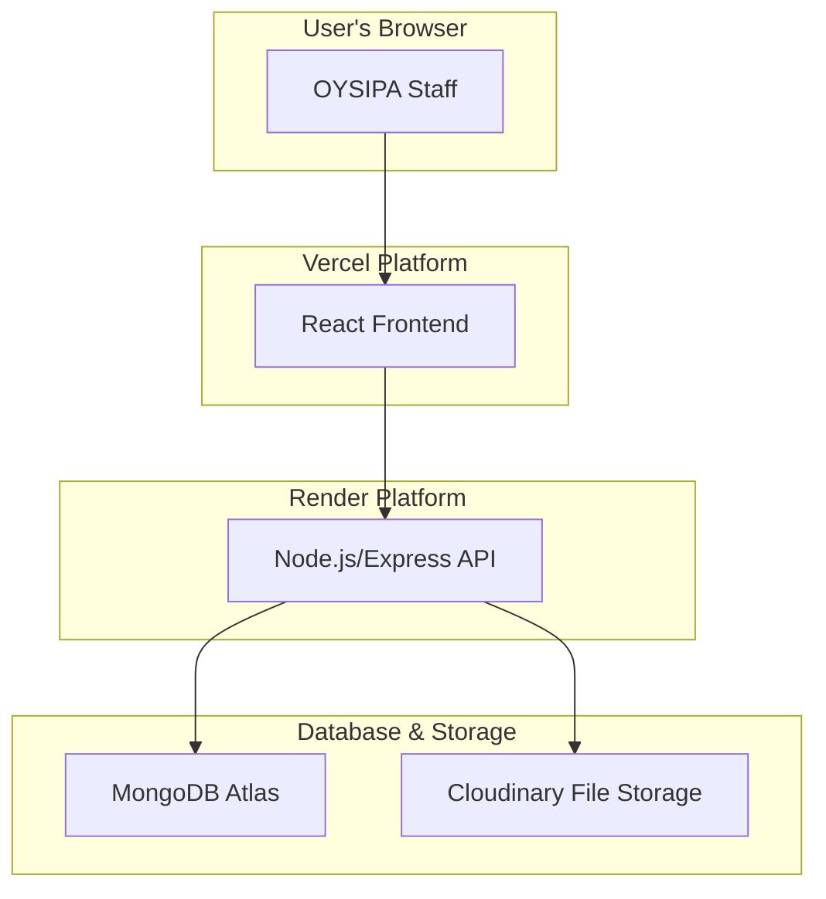

# 2. High Level Architecture

## 2.1. Technical Summary

The proposed architecture is a modern, decoupled, full-stack application. The frontend will be a **React (Vite)** single-page application, hosted on **Vercel** for optimal performance and continuous deployment. The backend will be a **Node.js with Express** API service, hosted on **Render**, which will handle all business logic and data processing. Data will be persisted in a **MongoDB Atlas** cluster, a managed NoSQL database solution. This stack provides a clear separation of concerns, allowing the frontend and backend to be developed, scaled, and deployed independently while meeting the project's requirements.

## 2.2. Platform and Infrastructure Choice

**Platform:** A combination of specialized cloud providers.
**Key Services:**
- **Vercel:** For continuous deployment and hosting of the React frontend application.
- **Render:** For hosting the backend Node.js/Express API service.
- **MongoDB Atlas:** For the managed MongoDB database cluster.
- **Cloudinary:** For secure file storage and delivery.
**Deployment Host and Regions:** US-East (Default for all services)

## 2.3. Repository Structure

**Structure:** Poly-repo (two separate repositories).
**Rationale:** Given the separate hosting platforms for frontend (Vercel) and backend (Render), a poly-repo approach is the most straightforward for configuration and deployment. It creates a clean separation between the two parts of the codebase.
- `oysipa-frontend`: Contains the React application.
- `oysipa-backend`: Contains the Node.js API service.

## 2.4. High Level Architecture Diagram

## 2.5. Architectural Patterns
- **Decoupled Frontend/Backend:** The frontend (presentation) and backend (business logic) are separate applications. _Rationale:_ This allows for independent development, deployment, and scaling, and enables a clear contract via the API.
- **REST API:** The backend will expose a RESTful API for the frontend to consume. _Rationale:_ This is a mature, well-understood standard for web APIs that is framework-agnostic.
- **Component-Based UI:** The React frontend will be built using reusable components, as defined in the UI/UX Specification. _Rationale:_ Enhances maintainability and consistency.
- **Repository Pattern (Backend):** Data access logic will be abstracted into a repository layer to decouple the Express services from MongoDB. _Rationale:_ This makes the code cleaner, easier to test, and allows for easier data-layer modifications in the future.
