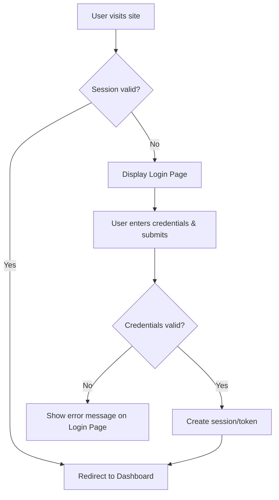
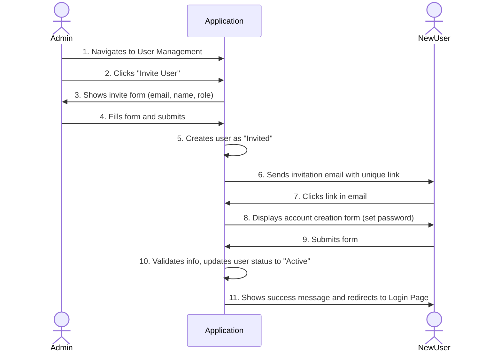
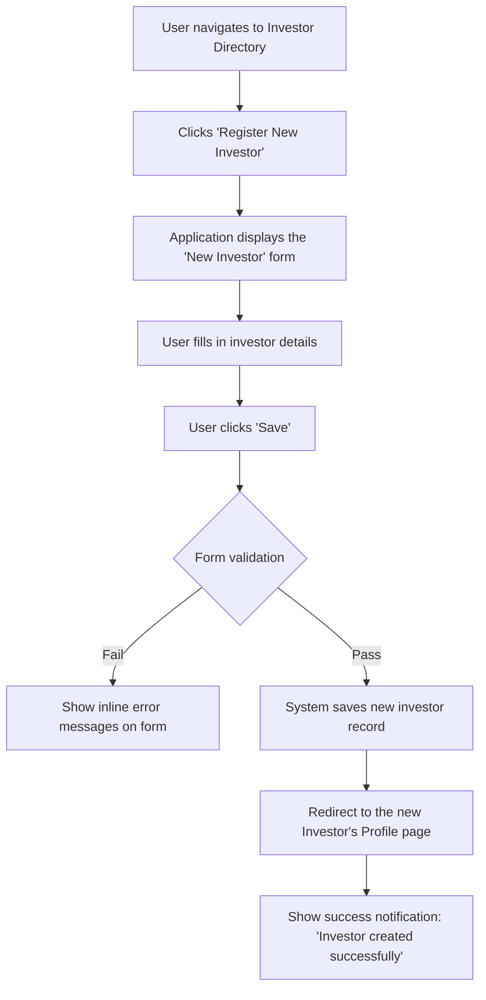
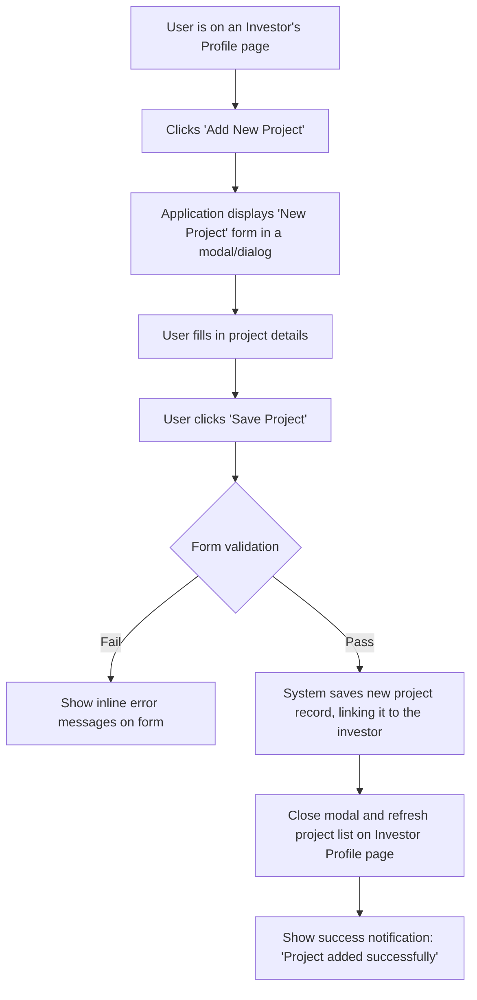
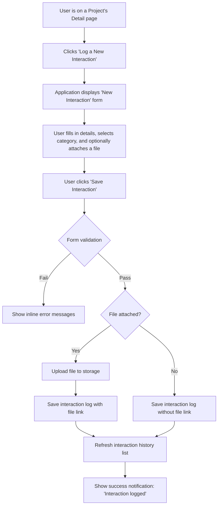

### 1.1. Overall UX Goals & Principles

#### 1.1.1. Target User Personas
*   **Director-General (DG):** The executive head who needs a high-level, strategic dashboard view for oversight and decision-making.
*   **Portal Administrator:** A trusted manager who needs simple, powerful tools for user management and work allocation.
*   **OYSIPA Staff:** The primary daily users who need an efficient, clear view of their assigned projects and a streamlined way to log interactions.

#### 1.1.2. Usability Goals
*   **Ease of Learning:** A new staff member should be able to log a new investor and a support interaction without assistance during their first session.
*   **Efficiency of Use:** Daily tasks, such as updating a project's status or finding an investor, should be achievable in three clicks or fewer from the main dashboard.
*   **Error Prevention:** The system will use clear validation and require confirmation for critical actions like revoking user access to prevent mistakes.
*   **Memorability:** An infrequent user, like the DG, should be able to navigate the dashboard and understand the data without needing to relearn the interface.

#### 1.1.3. Design Principles
1.  **Clarity and Precision:** The interface must be unambiguous. Prioritize clear data presentation and straightforward navigation over stylistic trends. Every piece of information should be easy to find and understand.
2.  **Role-Focused Efficiency:** Each user role should see only what they need to perform their job effectively. The design will be tailored to streamline the specific workflows of the Staff, Administrator, and DG.
3.  **Security and Trust:** The design will visually reinforce the security and integrity of the system. Users should feel confident that the data is safe, and their actions are being properly audited.
4.  **Guided Workflows:** The system will guide users through complex tasks, such as registering a new investor or updating a project's lifecycle, making the process intuitive and reducing cognitive load.
5.  **Accessible by Default:** The application will be designed from the ground up to be accessible, ensuring all users, regardless of ability, can interact with it effectively.

### 1.2. Change Log

| Date | Version | Description | Author |
| :--- | :--- | :--- | :--- |
| 2025-09-19 | 1.0 | Initial Draft | Sally (UX) |

## 2. Information Architecture (IA)

### 2.1. Site Map

```mermaid
graph TD
    subgraph Public Area
        A[Login Page]
    end

    subgraph Authenticated App
        B(Dashboard) --> C{User Role?}
        C --> D[Staff Dashboard]
        C --> E[DG Dashboard]
        C --> F[Admin Dashboard]

        G(Investor Directory) --> H(Investor Profile View)
        H --> I(Investment Project View)

        J(User Management) --> K(Invite User)
        J --> L(Revoke User)

        M(System Settings) --> N(Lifecycle Stages CRUD)
        M --> O(Email Templates CRUD)

        P(System Audit Log)
    end

    A --> B

    linkStyle 0 stroke-width:2px,fill:none,stroke:grey
    linkStyle 1 stroke-width:2px,fill:none,stroke:grey
    linkStyle 2 stroke-width:2px,fill:none,stroke:grey
    linkStyle 3 stroke-width:2px,fill:none,stroke:grey
    linkStyle 4 stroke-width:2px,fill:none,stroke:grey
    linkStyle 5 stroke-width:2px,fill:none,stroke:grey
    linkStyle 6 stroke-width:2px,fill:none,stroke:grey
    linkStyle 7 stroke-width:2px,fill:none,stroke:grey
    linkStyle 8 stroke-width:2px,fill:none,stroke:grey
    linkStyle 9 stroke-width:2px,fill:none,stroke:grey
    linkStyle 10 stroke-width:2px,fill:none,stroke:grey
    linkStyle 11 stroke-width:2px,fill:none,stroke:grey
    linkStyle 12 stroke-width:2px,fill:none,stroke:grey
    linkStyle 13 stroke-width:2px,fill:none,stroke:grey
```

### 2.2. Navigation Structure

**Primary Navigation:** A persistent, role-aware vertical sidebar menu will be the main method of navigating the application. The links displayed will be filtered based on the logged-in user's role.

*   **All Roles:** Dashboard, Investor Directory
*   **Portal Administrator & DG:** User Management, System Settings, System Audit Log

**Secondary Navigation:** For the MVP, there will be no secondary navigation system. All navigation will be handled through the primary sidebar and on-page links.

**Breadcrumb Strategy:** A breadcrumb navigation will be displayed at the top of every page below the main header. It will show the user's current location within the site hierarchy, providing clear context and an easy way to navigate back to parent pages. Example: `Home / Investor Directory / [Investor Name] / [Project Name]`

## 3. User Flows

### 3.1. Flow: User Login

**User Goal:** To securely access the application and be directed to the appropriate dashboard for their role.

**Entry Points:**
- Navigating to the application's root URL.
- Being redirected from a bookmarked internal page while unauthenticated.

**Success Criteria:**
- Upon successful authentication, the user is redirected to their role-specific dashboard.
- A secure session or token is created.

#### Flow Diagram


#### Edge Cases & Error Handling:
- **Invalid Credentials:** A clear, non-specific error message (e.g., "Invalid email or password") is shown.
- **Deactivated Account:** If a user whose access has been revoked attempts to log in, the same "Invalid email or password" error is shown for security.
- **Server Error:** A generic "An unexpected error occurred" message is shown if the authentication service is down.

**Notes:** This is the primary gateway to the application for all user roles. The process must be simple, secure, and reliable.

### 3.2. Flow: Invite New User

**User Goal:** For a Portal Administrator to grant system access to a new staff member, and for that new member to create their account.

**Entry Points:**
- Administrator navigates to the "User Management" page.

**Success Criteria:**
- A new user record is created with a status of "Invited".
- The new user receives an email with a unique registration link.
- The new user successfully creates their account, and their status is updated to "Active".
- The new user can log in successfully after creating their account.

#### Flow Diagram


#### Edge Cases & Error Handling:
- **Existing Email:** If the admin tries to invite an email that already exists, the system shows an error: "This email address is already registered."
- **Invalid Email Format:** The form validates that the email address is in a correct format.
- **Invite Link Expiration:** The registration link sent via email will expire after a set period (e.g., 72 hours) for security. If the user clicks an expired link, they will be shown a message with an option to request a new invitation.
- **Email Delivery Failure:** The system should log email delivery failures.

**Notes:** The invitation email must clearly state who it's from (OYSIPA) and what it's for. It should look professional and trustworthy.

### 3.3. Flow: Create New Investor

**User Goal:** For an OYSIPA staff member to add a new investor profile to the system, capturing all required information accurately.

**Entry Points:**
- User clicks the "Register New Investor" button from the "Investor Directory" page.

**Success Criteria:**
- A new investor record is successfully created in the database.
- The user is automatically redirected to the newly created investor's "Profile Detail" page.
- The new investor appears in the "Investor Directory" list.

#### Flow Diagram


#### Edge Cases & Error Handling:
- **Missing Required Fields:** The form will not submit, and inline error messages will appear next to each required field that is empty.
- **Duplicate Investor Name:** If an investor with the same name already exists, the system will show a confirmation warning (e.g., "An investor with this name already exists. Are you sure you want to create another?") to prevent accidental duplicates.
- **Invalid Data Format:** Fields with specific formats (e.g., website URL, registration number) will have input masks or validation to guide the user and prevent incorrect data entry.

**Notes:** The form design should be clean and organized into logical sections (e.g., "Company Information," "Key Contact") to make the data entry process as smooth as possible. This aligns with the "Guided Workflows" design principle.

### 3.4. Flow: Add New Project to Investor

**User Goal:** For a staff member to add a new, specific investment project to an existing investor's profile.

**Entry Points:**
- User clicks the "Add New Project" button from an investor's "Profile Detail" page.

**Success Criteria:**
- A new project record is created and correctly linked to the parent investor.
- The user is returned to the investor's "Profile Detail" page.
- The new project is immediately visible in the list of projects on that page.

#### Flow Diagram


#### Edge Cases & Error Handling:
- **Missing Required Fields:** The form will not submit, and inline error messages will appear next to each required field (e.g., Project Title).
- **Invalid Data Format:** Fields like "Estimated Value" will only accept numeric input.

**Notes:** Using a modal or dialog for this form, rather than navigating to a full new page, keeps the user in the context of the investor they are working with, making the experience faster and more efficient. This aligns with the "Role-Focused Efficiency" design principle.

### 3.5. Flow: Log a Support Interaction

**User Goal:** For a staff member to quickly and accurately record a support activity for a specific project, with the option to attach a supporting document.

**Entry Points:**
- User clicks the "Log a New Interaction" button from a project's "Project Detail" page.

**Success Criteria:**
- A new, timestamped interaction log is created and associated with the project.
- If a document was attached, it is uploaded and linked to the log entry.
- The new log entry is immediately visible at the top of the project's interaction history list.

#### Flow Diagram


#### Edge Cases & Error Handling:
- **Missing Required Fields:** The form will not submit if the description or service category is missing.
- **File Upload Failure:** If the file is too large or an unsupported type, a clear error message is shown. If the upload fails for a network reason, the user is notified so they can try again.
- **Network Error on Save:** If the form submission fails, the entered data should be preserved so the user doesn't lose their work.

**Notes:** This is a high-frequency activity. The form should be simple and placed prominently on the project page to allow for rapid data entry, supporting the "Efficiency of Use" usability goal.

## 4. Wireframes & Mockups

### 4.1. Design Files

**Primary Design Files:** All high-fidelity mockups and prototypes will be created and maintained in **Figma**. A link to the shared Figma project will be added here once it is initiated.

### 4.2. Key Screen Layouts

This section outlines the conceptual layout for the application's most critical screens. These are not final designs but serve as a blueprint for the wireframing and mockup phase.

#### 4.2.1. Screen: Dashboard (Role-Based)
*   **Purpose:** To provide a tailored, at-a-glance overview of the most relevant information for each user role.
*   **Key Elements:**
    *   **DG View:** A series of KPI widgets (Total Investors, Projects by Stage, etc.) as defined in the PRD.
    *   **Staff View:** A list or card view of "My Assigned Projects," showing the project title, investor name, and current stage.
    *   **Admin View:** May include quick links to User Management and System Settings, along with a summary of system activity.
*   **Interaction Notes:** DG's KPI widgets should be clickable, leading to filtered lists. Staff's project list should link directly to each project's detail page.
*   **Design File Reference:** [Link to Dashboard Frame in Figma will be added here]

#### 4.2.2. Screen: Investor Directory
*   **Purpose:** To allow users to search, filter, and browse the list of all investors in the system.
*   **Key Elements:**
    *   A prominent "Register New Investor" button.
    *   A search bar for finding investors by name.
    *   Filtering options (e.g., by sector, assigned staff member).
    *   A sortable table displaying key investor details (Name, Sector, Assigned Staff, Date Added).
*   **Interaction Notes:** Clicking on an investor's row in the table navigates to their "Profile Detail" page.
*   **Design File Reference:** [Link to Investor Directory Frame in Figma will be added here]

#### 4.2.3. Screen: Investor/Project Detail View
*   **Purpose:** To serve as the central hub of all information for a single investor and their associated projects.
*   **Key Elements:**
    *   **Investor Profile Section:** Displays all core details of the investor. "Edit" button for modification.
    *   **Projects Section:** A list of all projects associated with the investor. "Add New Project" button.
    *   **Interaction History Section:** A chronological log of all interactions for the selected project. "Log a New Interaction" form/button.
    *   **Lifecycle Stage Display:** Clearly shows the current stage of the selected project with an "Update Stage" button.
*   **Interaction Notes:** This will be a dense but clearly organized page. Tabs or accordions may be used to switch between different projects' details without leaving the main investor view.
*   **Design File Reference:** [Link to Detail View Frame in Figma will be added here]

#### 4.2.4. Screen: User Management
*   **Purpose:** To allow Administrators to manage user access.
*   **Key Elements:**
    *   An "Invite User" button that opens a simple form/modal.
    *   A list of all users showing their name, email, role, and status (Active, Invited, Revoked).
    *   Actions for each user (e.g., "Revoke Access," "Resend Invitation").
*   **Interaction Notes:** Critical actions like "Revoke Access" will require a confirmation dialog to prevent accidents.
*   **Design File Reference:** [Link to User Management Frame in Figma will be added here]

## 5. Component Library / Design System

### 5.1. Design System Approach

**Design System Approach:** To meet the 4-week MVP timeline while ensuring a high-quality, consistent, and accessible interface, this project will utilize an existing, comprehensive component library. The recommended library is **Material-UI (MUI)**.

This approach provides several key advantages:
- **Speed:** Leverages pre-built, production-ready components, dramatically accelerating frontend development.
- **Consistency:** Ensures a consistent look and feel across the entire application.
- **Accessibility:** MUI components are built with accessibility best practices in mind, helping us meet our WCAG 2.1 AA target.
- **Professional Aesthetic:** Provides a clean, modern, and professional design suitable for a government agency.

### 5.2. Core Components

The following is an initial list of core components from the chosen library that will be foundational to the application's UI.

#### 5.2.1. Component: Button
*   **Purpose:** To trigger primary, secondary, and tertiary actions.
*   **Variants:** `contained` (for primary actions like "Save"), `outlined` (for secondary actions), `text` (for minor actions).
*   **States:** Default, Hover, Disabled, Loading.
*   **Usage Guidelines:** Primary buttons should be used sparingly, typically once per view, for the main positive action.

#### 5.2.2. Component: Table
*   **Purpose:** To display sortable and filterable lists of data, such as the Investor Directory and User Management lists.
*   **Variants:** Will use MUI's `DataGrid` for advanced features like sorting, filtering, and pagination.
*   **States:** Loading (shows a skeleton screen or spinner), Empty (shows a "No data to display" message), Populated.
*   **Usage Guidelines:** Used for all primary data grids.

#### 5.2.3. Component: Form Inputs
*   **Purpose:** To handle all data entry and editing.
*   **Variants:** `TextField` (for text), `Select` (for dropdowns like "Role" or "Service Category"), `FileUpload` (custom component for document attachments).
*   **States:** Default, Focused, Error, Disabled.
*   **Usage Guidelines:** All inputs must have clear labels and helper text where appropriate. Validation errors will be displayed inline.

#### 5.2.4. Component: Modal/Dialog
*   **Purpose:** To handle contextual actions and forms without navigating the user away from the current page.
*   **Variants:** Standard dialogs for forms (e.g., "Add New Project"), and `AlertDialog` for confirmations (e.g., "Revoke Access?").
*   **Usage Guidelines:** Used to keep users in context for quick, focused tasks.

#### 5.2.5. Component: Card
*   **Purpose:** To display summarized information in a digestible format, primarily on dashboards.
*   **Variants:** Standard `Card` for lists (e.g., "My Assigned Projects"), and a variation for KPI widgets on the DG's dashboard.
*   **Usage Guidelines:** Cards will be the primary building block for all dashboard interfaces.

## 6. Branding & Style Guide

### 6.1. Visual Identity

**Brand Guidelines:** No official OYSIPA brand guidelines have been provided. Therefore, this document will establish a baseline professional style. This section can be updated with a link to official guidelines if they become available.

### 6.2. Color Palette

The color palette is designed to be professional, accessible, and modern, suitable for a government application.

| Color Type | Hex Code | Usage |
| :--- | :--- | :--- |
| Primary | `#850504` | Primary buttons, links, key UI elements |
| Secondary | `#F9F9F9` | Page backgrounds, card backgrounds |
| Accent | `#0A558C` | Hover states, secondary actions |
| Success | `#198754` | Positive feedback, confirmations |
| Warning | `#FFC107` | Cautions, important notices |
| Error | `#DC3545` | Errors, destructive actions |
| Neutral | `#212529` to `#6C757D` | Text, borders, backgrounds |

### 6.3. Typography

#### 6.3.1. Font Families
- **Primary:** 'Poppins' - A clean, highly readable sans-serif font, well-suited for user interfaces. It will be used for all text.
- **Monospace:** 'Roboto Mono' - To be used for any code snippets or raw data displays if needed.

#### 6.3.2. Type Scale

| Element | Size | Weight | Line Height |
| :--- | :--- | :--- | :--- |
| H1 | 32px | 700 (Bold) | 1.2 |
| H2 | 24px | 700 (Bold) | 1.3 |
| H3 | 20px | 600 (Semi-Bold) | 1.4 |
| Body | 16px | 400 (Regular) | 1.5 |
| Small | 14px | 400 (Regular) | 1.5 |

### 6.4. Iconography

**Icon Library:** We will use the **Material Icons** library, which is integrated with the chosen Material-UI component library. This ensures visual consistency between components and icons.

**Usage Guidelines:** Icons should always be used with a visible text label, unless the icon's meaning is universally understood (e.g., a trash can for delete).

### 6.5. Spacing & Layout

**Grid System:** A standard 8-point grid system will be used for all layouts. This means that all spacing and component dimensions will be in increments of 8px.

**Spacing Scale:** The base unit will be 8px. Common spacing values will be 8px, 16px, 24px, 32px, 48px, etc. This ensures a harmonious and consistent rhythm throughout the application.

## 7. Accessibility Requirements

### 7.1. Compliance Target

**Standard:** The application will adhere to the **Web Content Accessibility Guidelines (WCAG) 2.1 at the Level AA** standard.

### 7.2. Key Requirements

The following outlines the practical application of the WCAG 2.1 AA standard for this project.

#### Visual:
- **Color Contrast:** All text will have a minimum contrast ratio of 4.5:1 against its background to ensure readability for users with low vision.
- **Focus Indicators:** All interactive elements (buttons, links, form fields, etc.) will have a highly visible and distinct focus state, making keyboard navigation clear.
- **Text Sizing:** Users must be able to resize text up to 200% using browser controls without loss of content or functionality.

#### Interaction:
- **Keyboard Navigation:** All functionality of the application, including forms, buttons, and navigation, must be operable through a keyboard alone, without requiring a mouse.
- **Screen Reader Support:** The application will be tested for compatibility with modern screen readers (e.g., NVDA, VoiceOver). All components will use proper semantic HTML and ARIA attributes where necessary.
- **Touch Targets:** On mobile devices, all interactive elements will have a minimum touch target size of 44x44 pixels to be easily tappable.

#### Content:
- **Alternative Text:** All meaningful images must have descriptive `alt` text. Decorative images will have empty `alt` attributes.
- **Heading Structure:** Headings (H1, H2, H3, etc.) will be used in a logical, nested order to structure content, not for purely stylistic reasons.
- **Form Labels:** Every form input will have a programmatically associated `<label>` to ensure clarity for all users.

### 7.3. Testing Strategy

A multi-layered approach will be used to ensure compliance:
1.  **Automated Testing:** An automated tool like `axe-core` will be integrated into the development pipeline to catch common accessibility violations automatically.
2.  **Manual Keyboard Testing:** Before any feature is considered complete, the developer must verify that it can be fully operated using only the Tab, Shift+Tab, Enter, and Spacebar keys.
3.  **Screen Reader Spot-Checks:** Key user flows (e.g., Login, Create Investor, Log Interaction) will be manually tested with a screen reader to ensure a usable experience for visually impaired users.

## 8. Responsiveness Strategy

### 8.1. Breakpoints

The application will use a standard set of breakpoints to ensure a consistent experience across all target devices. These breakpoints align with the Material-UI grid system.

| Breakpoint | Min Width | Target Devices |
| :--- | :--- | :--- |
| Mobile | 0px | Smartphones (portrait and landscape) |
| Tablet | 600px | Tablets (portrait and landscape) |
| Desktop | 960px | Desktops, Laptops |
| Wide | 1280px | Large desktop monitors |

### 8.2. Adaptation Patterns

- **Layout Changes:** On mobile screens, multi-column layouts (e.g., dashboards, complex forms) will stack vertically into a single column to ensure readability. On tablets, a two-column layout may be used where appropriate.
- **Navigation Changes:** The primary sidebar navigation will be permanently visible on Desktop and Wide screens. On Tablet and Mobile screens, it will be collapsed by default and accessible via a "hamburger" menu icon in the main header.
- **Content Priority:** For data-dense views like the Investor/Project Detail page, information on mobile may be organized into accordion-style collapsible sections to prevent vertical scrolling fatigue.
- **Interaction Changes:** All hover-based interactions on desktop will have a direct touch-based equivalent (e.g., a tap) on mobile and tablet devices. Data tables will become horizontally scrollable on small screens if their content cannot be gracefully wrapped or stacked.

## 9. Animation & Micro-interactions

### 9.1. Motion Principles

The use of animation will be subtle, consistent, and purposeful, aiming to enhance usability without causing distraction or performance issues.
1.  **Purposeful and Informative:** Animation must have a clear purpose, such as guiding a user's attention, providing feedback for an action, or indicating a state change.
2.  **Responsive and Performant:** All animations must be smooth (targeting 60fps) and optimized to prevent any negative impact on application load times or responsiveness.
3.  **Consistent and Predictable:** Motion patterns will be used consistently throughout the application to create a predictable and professional user experience.

### 9.2. Key Animations

- **State Transitions:** Subtle cross-fade transitions will be used when components change state (e.g., a button becoming disabled, a form field showing an error). (Duration: 150ms, Easing: Ease-out)
- **Modal/Dialog Entry:** Modals and dialogs will fade in with a slight scale-up effect to gently draw the user's attention. (Duration: 200ms, Easing: Ease-in-out)
- **Loading Indicators:** For loading states in tables or cards, a subtle "skeleton" loading effect (pulsing grey shapes) will be used in preference to a generic spinner to better indicate the shape of the content that is loading.
- **Expand/Collapse:** Accordions and other collapsible sections will use a smooth slide-down/slide-up animation to reveal or hide content. (Duration: 200ms, Easing: Ease-in-out)

## 10. Performance Considerations

### 10.1. Performance Goals

The application must feel fast and responsive. We will measure this using the following Core Web Vitals targets:
- **Largest Contentful Paint (LCP):** Should be **below 2.5 seconds** to ensure the main content of a page loads quickly.
- **First Input Delay (FID):** Should be **below 100 milliseconds** to ensure the UI responds instantly to user interaction.
- **Interaction to Next Paint (INP):** All UI feedback, such as button clicks and form validation, should feel instantaneous (well under 200ms).

### 10.2. Design Strategies

The following design and development strategies will be employed to achieve our performance goals:
- **Image Optimization:** Any uploaded images (e.g., for user profiles or document previews) will be automatically compressed and served in modern, efficient formats like WebP.
- **Lazy Loading:** Images, components, and data that are not immediately visible ("below the fold") will be loaded on demand as the user scrolls, reducing initial page load times.
- **Skeleton Screens:** When fetching data for dashboards, tables, or cards, the UI will display "skeleton" placeholders. This improves perceived performance by showing the shape of the content before it has fully loaded.
- **Code Splitting:** The application's code will be split by page or feature, so users only download the JavaScript necessary for the view they are currently interacting with.

## 11. Next Steps

### 11.1. Immediate Actions

1.  **Formal Review:** This UI/UX Specification document should be formally reviewed and approved by all key stakeholders.
2.  **High-Fidelity Design:** Begin creating high-fidelity mockups and a clickable prototype in Figma, using this document as the definitive guide.
3.  **Architectural Handoff:** Schedule a meeting with the project Architect to review this specification. This will serve as a primary input for creating the detailed `front-end-architecture.md` document.

### 11.2. Design Handoff Checklist

- [x] All user flows documented
- [x] Component inventory complete
- [x] Accessibility requirements defined
- [x] Responsive strategy clear
- [x] Brand guidelines incorporated
- [x] Performance goals established